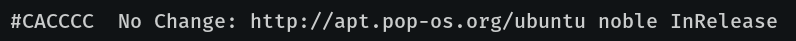
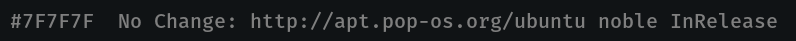
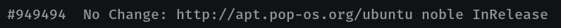
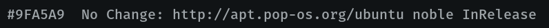
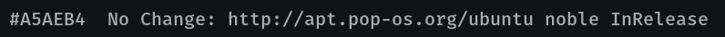
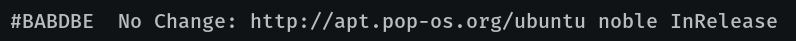

# COSMIC Terminal schemes

Colour schemes for COSMIC Terminal. The desktop `.ron` in `cosmic/` does not
colour ANSI text, so the terminal needs its own import.

1. COSMIC Terminal → **View → Color schemes…** (not Settings → Appearance)
2. **Dark** tab → **Import** → a `.ron` from this folder
3. View → Settings → Appearance → Color scheme (dark) → the scheme name

If a profile is set as default, set the scheme on that profile too or the
dropdown will look like it did nothing. `cosmic/install.sh` selects **K3**,
so import that one at least.

Every scheme here keeps the 16 ANSI colours of K3. Only the plain text
colour and the dim text change, so bat, lsd, starship, nala and btop look the
same whichever one you pick. The cursor stays steel  `#798186`.

The ANSI slots follow the rice: `red` is terracotta  `#DE6145`, the one colour
kept for what is wrong; `green` is mist  `#9FA5A9`; `yellow` is khaki
 `#C9C2B4`; `blue` is the steel accent  `#798186`, so nala's `Updated:` and
`Downloaded:` labels sit in the rice's own colour next to the mist
`No Change:`; `magenta` is orange  `#D87C4A`, the warm colour numbers and
warnings take; `cyan` is the muted grey  `#707070`; `white` is the warm pale
 `#CBC2BE`. Directories are not affected: `LS_COLORS` in `zsh/k3.zsh` colours
them in truecolor.

## Which one

Silver  `#CACCCC` is the default and the brightest. At night it can glare, so
the others step down through K3's own greys. Lower in the list is brighter and
easier to read for long stretches; higher is calmer.

| Scheme | Plain text | Contrast | Also used for |
|--------|------------|----------|---------------|
| K3 Smoke |  `#7F7F7F` | 4.7:1 | muted text, the dim text colour |
| K3 Pewter |  `#949494` | 6.2:1 | directories (`LS_COLORS`), the bright `cyan` slot |
| K3 Mist |  `#9FA5A9` | 7.5:1 | strings, success, the `green` slot |
| K3 Ash |  `#A5AEB4` | 8.3:1 | the desktop text tint |
| K3 Pale |  `#BABDBE` | 9.9:1 | none, one step below silver |
| **K3** (default) |  `#CACCCC` | 11.6:1 | the desktop text colour |

When plain text shares a colour with an ANSI slot, output in that slot stops
standing out: directories in K3 Pewter, for example, look like plain text.
Terracotta errors and orange numbers stand out more against the dimmer
schemes than against silver.

**Bold:** `bright_foreground` ( `#D5D5D5`) only colours bold text when
`use_bright_bold` is on. The baseline config in `cosmic/config/` leaves it off,
so bold text is the plain text colour at weight 800.

Previews are rendered in Fira Mono on the theme background  `#101315`, not
taken from the terminal. In COSMIC you get Maple Mono at 77% opacity over the
wallpaper, so text looks a little softer and contrast a little lower.

## Dark

**K3** · `K3-term.ron` · silver  `#CACCCC`, 11.6:1. The default.

**K3 Smoke** · `K3-term-smoke.ron` ·  `#7F7F7F`, 4.7:1. The dimmest that
still clears 4.5:1 on the background. Good for a low-glare look at night,
tiring for long reading.

**K3 Pewter** · `K3-term-pewter.ron` ·  `#949494`, 6.2:1. The directory
colour; plain text matches directories.

**K3 Mist** · `K3-term-mist.ron` ·  `#9FA5A9`, 7.5:1. The cool one, K3's
string and success colour. Plain text sits on the `green` slot.

**K3 Ash** · `K3-term-ash.ron` ·  `#A5AEB4`, 8.3:1. The desktop text tint,
a touch of blue in the grey.

**K3 Pale** · `K3-term-pale.ron` ·  `#BABDBE`, 9.9:1. One step below silver.

Contrast is plain text on the theme background, WCAG 2.
