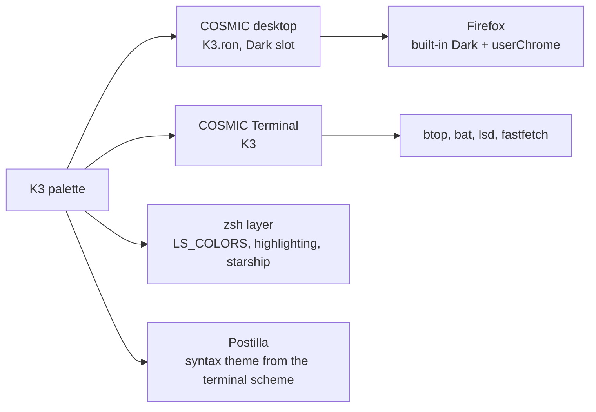

# K3

> Ink, steel and silver, with terracotta kept for what is wrong. A dark rice with no loud colour.

Pop!_OS 24.04 on the COSMIC desktop, one palette carried through the whole
machine: desktop, terminal, shell, editor, browser. This note is the rice
describing itself, written in Markdown and rendered by **Postilla**.

## Palette

Every text colour is checked against the window background  `#101315`.

| Role | Hex | Contrast on background |
|------|-----|------------------------|
| Text |  `#CACCCC` | 11.6:1 |
| Steel, accent |  `#798186` | 4.7:1 |
| Orange, warning |  `#D87C4A` | 6.1:1 |
| Terracotta, error |  `#DE6145` | 5.2:1 |
| Mist, success |  `#9FA5A9` | 7.5:1 |
| Khaki, symlinks |  `#C9C2B4` | 10.5:1 |
| Pewter, directories |  `#949494` | 6.2:1 |
| Muted |  `#7F7F7F` | 4.7:1 |

Containers sit one step away from the background at  `#212121`, which is
what frosted glass blurs into.

## Where the colours go



## Setup, in order

- [x] Import `cosmic/K3.ron` into Appearance, **Dark** slot
- [x] Import `cosmic-term/K3-term.ron`, pick **K3** for the profile
- [x] `./icons/install.sh` for the **Cosmic-K3** icons, `./cosmic/install.sh` for fonts and the terminal look
- [x] `./zsh/install.sh`, `./lsd/install.sh`, `./fastfetch/install.sh`
- [x] Cursor: Oxygen-K3-Steel
- [x] Wallpaper: `backgrounds/k3-anime.png`
- [ ] Screenshot for the README

## The baseline every rice shares

```ron
corner_radii: (
    radius_xs: (2.0, 2.0, 2.0, 2.0),   // squared corners
    radius_xl: (2.0, 2.0, 2.0, 2.0),
),
frosted: Low,
frosted_windows: true,
frosted_panel: true,
frosted_applets: true,
frosted_maximized_apps: false,
gaps: (0, 7),
active_hint: 1,
```

Contrast is the WCAG ratio[^1], where $L$ is relative luminance:

```typst
$ (L_1 + 0.05) / (L_2 + 0.05) >= 4.5 $
```

---

*Rendered in Postilla, a Markdown notes app for COSMIC. The window is painted
with this rice's terminal scheme, imported as a syntax theme.*

[^1]: Web Content Accessibility Guidelines, success criterion 1.4.3. Normal text wants 4.5:1, large text 3:1.
